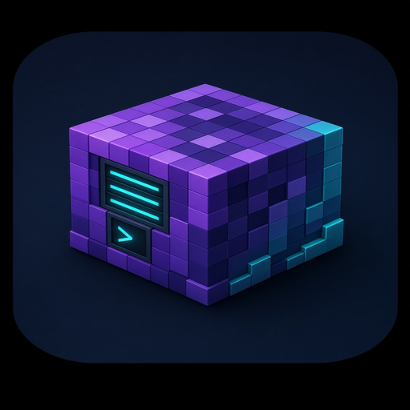

<p align="center">
  
</p>

<h1 align="center">DamaCraft</h1>

<p align="center">
  Gestionnaire de serveurs Minecraft pour macOS — SwiftUI, macOS 14 (Sonoma) ou plus.
</p>

## Télécharger

1. Va dans l'onglet **[Releases](../../releases)** du dépôt et télécharge `DamaCraft-x.y.z.dmg`.
2. Ouvre le `.dmg` et glisse **DamaCraft** dans **Applications**.
3. Au premier lancement, macOS peut afficher *« Apple ne peut pas vérifier… »* (l'app n'est pas encore notarisée) :
   **Réglages Système → Confidentialité et sécurité → « Ouvrir quand même »**. Une seule fois suffit.
4. Installe un JDK si ce n'est pas déjà fait (Java 21 ou plus pour les versions récentes de Minecraft) : <https://adoptium.net>

Le binaire est universel : il tourne sur Mac Apple Silicon et Intel.

## Fonctionnalités

- **Création de serveurs** Paper, Spigot (compilé par BuildTools), Purpur et Vanilla ; choix du dossier, de la version et de la mémoire.
- **Multi-serveurs**, tableau de bord (CPU, RAM, TPS, ping, port), graphique de performances, console avec historique de commandes.
- **Marketplace Modrinth** : plugins et mods filtrés selon la version de Minecraft et le loader de ton serveur.
- Éditeur de `server.properties` (interrupteurs pour les booléens) et des configs `.yml` de plugins.
- **Sauvegardes** manuelles ou automatiques, cohérentes à chaud (`save-off` / `save-all`), rotation, restauration avec conservation de l'ancien monde.
- Joueurs (kick, ban, op, mode de jeu), whitelist, notifications macOS, webhook Discord, RCON.
- Redémarrage automatique après plantage (avec garde-fou) et watchdog basé sur le ping du serveur.
- Barre de menus, arrêt propre du serveur quand on quitte l'app, 5 couleurs d'accent.

## Compiler soi-même

```bash
./scripts/build.sh app       # dist/DamaCraft.app
./scripts/build.sh dmg       # dist/DamaCraft-<version>.dmg
./scripts/build.sh install   # compile et installe dans ~/Applications
# ou double-clic sur Installer-DamaCraft.command
```

Prérequis : Xcode 15 ou plus (ou les Command Line Tools). `VERSION=1.2.0 ./scripts/build.sh dmg` fixe le numéro de version.

## Publier une nouvelle version

Le workflow `.github/workflows/release.yml` construit le `.dmg` sur un runner macOS à chaque push, et **crée une Release GitHub** pour chaque tag `v*` :

```bash
git tag v1.0.0
git push origin v1.0.0
```

Quelques minutes plus tard, `DamaCraft-1.0.0.dmg` (et son `.sha256`) apparaît dans les Releases.

> **Notarisation.** Sans compte Apple Developer payant, l'app est seulement signée « ad hoc », d'où l'étape « Ouvrir quand même ». Pour la supprimer il faudra signer avec un certificat *Developer ID* et notariser le `.dmg`.

## Notes techniques

- Les téléchargements Paper passent par l'API **Fill v3** (`fill.papermc.io`) ; l'ancienne API v2 est désactivée depuis le 1ᵉʳ juillet 2026.
- Les réglages sont stockés dans les préférences utilisateur (`UserDefaults`), par serveur.
